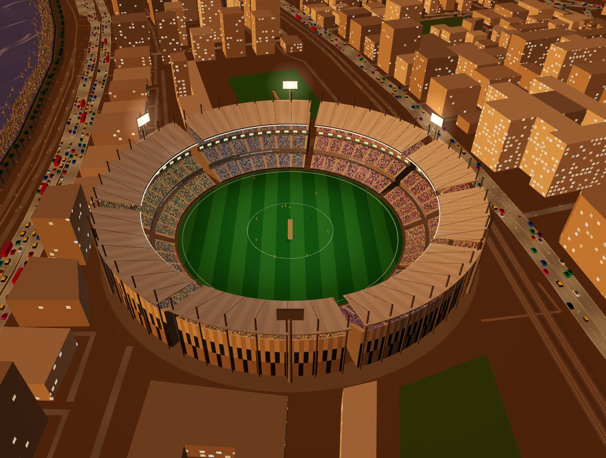

# SightScreen

See your seat's view before you buy the ticket. SightScreen is a browser-based, interactive 3D seat-view previewer for cricket stadiums. Buying a ticket usually means guessing from a flat seating chart, and you only learn about a blocked view, a long throw to the pitch or glare from the sun once you are in your seat. SightScreen removes that guesswork.

Orbit and zoom around a 3D model of the ground, pick a stand, block or seat, and see the pitch from exactly there. Switch the time of day to check sun, shade and floodlit evenings. When you have found a seat you like, jump straight to a booking site. Nothing to install and no account needed.

🏟️ Find your view → [<u>thefaraazansari.github.io/sightscreen</u>](https://thefaraazansari.github.io/sightscreen/)

<table>
  <tr>
    <td align="center">
      <br>
      🏏 Wankhede Stadium · Mumbai
    </td>
    <td width="40"></td>
    <td align="center">
      <br>
      🏏 Melbourne Cricket Ground · Melbourne
    </td>
  </tr>
</table>

## Tech Stack


| Role | Tech |
| --- | --- |
| UI | React 19, Tailwind CSS 4 |
| 3D | Three.js, React Three Fiber, drei |
| State | Zustand |
| Tooling | TypeScript, Vite, Biome (linting and formatting) |

## Quick Start

1. Clone the repo and enter it:

```sh
git clone https://github.com/thefaraazansari/sightscreen.git
cd sightscreen
```

2. Install dependencies:

```sh
npm install
```

3. Start the dev server:

```sh
npm run dev
```

4. Open the local URL Vite prints, usually http://localhost:5173.

| Command           | What it does                        |
| ----------------- | ----------------------------------- |
| `npm run dev`     | Start the dev server                |
| `npm run build`   | Type-check and build into `dist/`   |
| `npm run preview` | Serve the production build          |
| `npm run lint`    | Lint and check formatting (Biome)   |
| `npm run format`  | Auto-fix lint issues and formatting |

## Deployment & Releases

Every push to `main` runs the workflow in `.github/workflows/deploy.yml`. It has three jobs that run in order, and each one starts only if the previous one succeeds:

1. **Build.** Checks out the code, installs dependencies with `npm ci` on Node 22, runs `npm run build`, and uploads `dist/` as the Pages artifact.
2. **Deploy.** Publishes that artifact to GitHub Pages, which updates the live site.
3. **Release.** Creates a GitHub release with auto-generated notes. It is named `SightScreen vX.Y.Z` and tagged `vX.Y.Z`. The workflow finds the latest `v1.*.*` tag and raises the patch number by one. The first release is `v1.0.0`.

A push that arrives while a run is in progress waits for it to finish instead of cancelling it. If several pushes arrive during one run, only the newest one waits and the older ones are skipped, so they get no release of their own. A failed build or deploy means no release is created.

One-time setup: in the repo go to Settings → Pages → Source and choose **GitHub Actions**.

---

<div align="center">⭐ Star the repo if SightScreen helped you pick a seat · Made with ❤️ by Faraaz Ansari</div>
